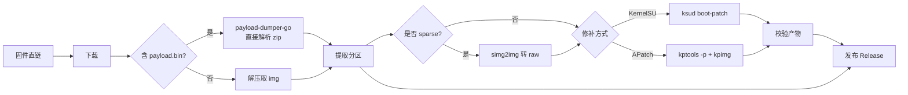

# KernelSU / APatch Patcher · GitHub Actions

在云端自动完成：**下载固件 → 解包提取分区 → 修补（KernelSU 或 APatch）→ 发布 Release**。

全程由 GitHub Actions 运行，无需本地环境，也不必把 ROM 拉到自己机器上。

- **`Build KernelSU Patched Images`** — 走 KernelSU 的 `ksud boot-patch`（LKM），通常修补 `boot` / `init_boot`
- **`Build APatch Patched Images`** — 走 APatch（KernelPatch）的 `kptools`，修补内核，只刷 `boot`

> 本仓库当前默认分支为 `dev`（同时包含 KernelSU 与 APatch）；`main` 分支只保留 KernelSU。

## ✨ 功能

- 🔗 **直链下载固件** — 支持多个链接、断点续传、aria2c 多线程加速
- 📦 **自动解包** — 自动识别 OTA 包（`payload.bin`）、fastboot 包、`super.img` 动态分区
- 🎯 **自定义提取分区** — 想提哪个提哪个（`boot` / `init_boot` / `vendor_boot` / …）
- 🧩 **版本自动跟进** — KernelSU 默认取 `latest` release；APatch 的 KernelPatch 版本默认跟随
  APatch 上游打包版本（`app/src/main/cpp/version`），也可手动锁定
- 🔍 **KMI 三级自动判定** — 内核探测 → 内核版本识别 → ramdisk `build.prop` 反推（KernelSU）
- 🧠 **可修补性诊断** — 非 GKI 内核（KernelSU）／内核未开 `CONFIG_KALLSYMS`（APatch）
  都会给出明确原因，而不是抛出含糊的错误
- ✅ **产物校验** — magic、页对齐、`kernelsu.ko`（KernelSU）或内核 `patched=true`（APatch）
- 🚀 **自动发布 Release** — 修补后的镜像与原始分区一并上传，附 `SHA256SUMS.txt`

## 🚀 使用方法

### 1. Fork 本仓库

### 2. 触发构建

进入 **Actions**，按需要选一个工作流：

#### A. KernelSU —— `Build KernelSU Patched Images`

| 参数 | 说明 | 示例 |
|---|---|---|
| `firmware_url` | **（必填）** 固件直链 | `https://example.com/ota.zip` |
| `partitions` | 要提取并发布的原始分区 | `boot,init_boot,vendor_boot` |
| `patch_partitions` | 要修补的分区（留空=同上） | `init_boot` |
| `kernelsu_version` | KernelSU 版本 | `latest` / `v3.3.0` |
| `kmi` | 强制指定 KMI（留空自动判定） | `android15-6.6` |
| `arch` | 目标架构 | `aarch64` / `x86_64` |
| `release_tag` | 自定义 Release tag | `my-pixel8-ksu` |
| `allow_shell` | 允许 shell 获取 root | `false` |
| `enable_adbd` | 强制开启 adbd 并关闭鉴权 | `false` |
| `cmdline` | 追加到 boot 头的 cmdline | 留空 |
| `extract_all` | 提取 payload 内全部分区 | `false` |
| `create_release` | 是否创建 Release | `true` |

#### B. APatch —— `Build APatch Patched Images`

| 参数 | 说明 | 示例 |
|---|---|---|
| `firmware_url` | **（必填）** 固件直链 | `https://example.com/ota.zip` |
| `partitions` | 要提取分区，**默认只取 `boot`** | `boot` |
| `patch_partitions` | 要修补的分区（留空=同上） | `boot` |
| `superkey` | **（必填）** APatch SuperKey | 见下方说明 |
| `kernelpatch_version` | KernelPatch 版本 | `auto`（跟随 APatch）/ `0.13.9` |
| `apatch_version` | APatch 管理器版本（命名/说明用） | `latest` / `11282` |
| `release_tag` | 自定义 Release tag | `my-pixel8-apatch` |
| `allow_no_kallsyms` | 内核没开 `CONFIG_KALLSYMS` 也强行修补 | `false` |
| `extract_all` | 提取 payload 内全部分区 | `false` |
| `create_release` | 是否创建 Release | `true` |

**关于 SuperKey**

- 规则与 APatch App 一致：**8~63 位，且必须同时包含字母和数字**（例如 `MyPhone2026`）
- 它既用于修补镜像，也要在开机后于 APatch App 里输入，两边必须一致
- ⚠️ **仓库是公开的**：填写在输入框里的 SuperKey 会记录在 run 事件中，任何人都能看到。
  推荐改用仓储 Secret（**Settings → Secrets and variables → Actions → Secrets**）：

  | Secret 名 | 说明 |
  |---|---|
  | `APATCH_SUPERKEY` | APatch SuperKey（存在时优先于输入框） |

  脚本会把密钥在日志中打码（`::add-mask::`），但公开仓库仍建议走 Secret。

### 3. 取回产物

构建完成后，产物在两个地方：

- **Releases** — `patched/`（已 Root 镜像）、`partitions/`（原始分区）、`SHA256SUMS.txt`
- **Artifacts** — 同一份内容，保留 14 天

## ⏰ 定时自动构建

`build.yml` 里预留了每周一 03:00 UTC 的定时任务（当前**已注释**，需要时自行解除注释）。
定时任务需要配置默认固件地址（**Settings → Secrets and variables → Actions → Variables**）：

| 变量名 | 说明 |
|---|---|
| `DEFAULT_FIRMWARE_URL` | 定时任务使用的固件直链（两个工作流都会优先使用 `firmware_url`） |

## 📥 刷入

```bash
# 校验完整性
sha256sum -c SHA256SUMS.txt

adb reboot bootloader

# KernelSU：注意区分 boot / init_boot，以及 A/B 槽位
fastboot flash init_boot init_boot-v3.3.0-patched.img

# APatch：修补的是内核，刷 boot 分区
fastboot flash boot boot-APatch-0.13.9-patched.img

fastboot reboot
```

> ⚠️ **务必确认固件版本与设备完全匹配**。刷错分区的 boot 镜像可能导致无法开机。
> 刷入前请先备份原分区：
> ```bash
> adb shell su -c "dd if=/dev/block/by-name/init_boot of=/sdcard/stock_init_boot.img"
> ```
>
> APatch 开机后打开 App，在「安装 / 修补」处输入构建时使用的 SuperKey 即可接管 root。

## 🧠 KernelSU：关于 KMI 与 boot / init_boot

KernelSU 通过 **LKM（可加载内核模块）** 方式工作，必须匹配设备的 **KMI**
（Kernel Module Interface，如 `android15-6.6`）。

脚本会按以下顺序自动判定 KMI：

1. **内核探测** — 直接在镜像中搜索 `android15-6.6` 这类字符串
2. **内核版本识别** — 解析 `Linux version 6.6.66-android15-...` 横幅
3. **ramdisk 反推** — `init_boot` 不含内核时，读取其 `build.prop` 里的
   Android 版本（如 `15`），匹配唯一的候选 KMI

若都无法确定（例如 `init_boot` 里没有 `build.prop`），请手动指定 `kmi` 参数。

查看自己设备的 KMI：

```bash
adb shell uname -r
# 例如输出 6.6.66-android15-8-gxxx  →  KMI 为 android15-6.6
```

若不确定该修补 `boot` 还是 `init_boot`：

| Android 版本 | 通常修补 |
|---|---|
| Android 12 及以下 | `boot` |
| Android 13 及以上 | `init_boot` |

## 🩹 APatch：修补原理与限制

APatch 基于 **KernelPatch**，直接给**内核**打补丁，然后把补丁信息（含 SuperKey 的哈希）
写回 `boot.img`，因此：

- 只需要 `boot` 分区；`init_boot` / `vendor_boot` 不含内核，**无法**用它修补
- 不依赖 GKI 版本号，也不改 ramdisk
- 要求内核开启 **`CONFIG_KALLSYMS`**（强烈建议 `CONFIG_KALLSYMS_ALL`），
  否则打上的补丁无法定位内核符号，开机会失败

脚本在修补前会解开内核、读取内嵌的 `ikconfig` 并检查上述两项：

| 检查结果 | 处理 |
|---|---|
| `CONFIG_KALLSYMS=y` + `CONFIG_KALLSYMS_ALL=y` | 正常修补 |
| 缺 `CONFIG_KALLSYMS_ALL` | 告警，可能无法开机 |
| 缺 `CONFIG_KALLSYMS` | 直接失败（`allow_no_kallsyms=true` 可强行继续） |
| 内核未开 `CONFIG_IKCONFIG`（读不到配置） | 告警并跳过检查 |

工具链全部来自 KernelPatch 官方 release：

- `kptools-linux` — x86_64 静态工具，负责解包 / 打补丁 / 重打包
- `kpimg-android` — 注入内核的补丁镜像（arm64）

修补命令与 APatch App 内置的 `boot_patch.sh` 完全一致：

```bash
kptools unpack boot.img                 # 解出 kernel，做可修补性检查
kptools -p -i boot.img -S <superkey> -k kpimg -o patched.img
```

## 📁 项目结构

```
.
├── .github/workflows/
│   ├── build.yml                  # KernelSU 主流程
│   ├── build-apatch.yml           # APatch 主流程
│   └── smoke.yml                  # 冒烟测试
├── scripts/
│   ├── utils.py                   # 公共工具（日志/命令/工具定位/KMI 推断）
│   ├── setup_tools.py             # 安装 payload-dumper-go、lpunpack、magiskboot
│   ├── fetch_kernelsu.py          # 获取最新 KernelSU 与 ksud
│   ├── fetch_apatch.py            # 获取 KernelPatch 的 kptools 与 kpimg
│   ├── download.py                # 固件下载（断点续传/aria2c）
│   ├── unpack.py                  # 解包并提取分区
│   ├── patch.py                   # KernelSU 修补
│   ├── patch_apatch.py            # APatch 修补（kptools）
│   ├── verify.py                  # 产物校验（--mode kernelsu|apatch）
│   ├── release.py                 # 整理发布产物
│   └── gen_notes.py               # 生成 Release 说明
├── tests/smoke_test.py            # 冒烟测试
└── tools/                         # 运行时自动下载的工具（不入库）
```

## 🔧 工作流程



## 🧪 本地测试

```bash
# 1. 准备工具
python3 scripts/setup_tools.py
python3 scripts/fetch_kernelsu.py          # KernelSU（ksud）
python3 scripts/fetch_apatch.py            # APatch（kptools + kpimg）

# 2. 运行冒烟测试
python3 tests/smoke_test.py

# 3. 单步调试
python3 scripts/download.py --urls "https://example.com/ota.zip" --out-dir downloads
python3 scripts/unpack.py   --input downloads --partitions boot,init_boot
python3 scripts/patch.py    --images work/unpacked/partitions/boot.img
python3 scripts/patch_apatch.py --images work/unpacked/partitions/boot.img \
        --superkey MyPhone2026 --out-dir work/patched
python3 scripts/verify.py   --patched work/patched/boot-*.img
python3 scripts/verify.py   --mode apatch --patched work/patched/boot-APatch-*.img
```

> 把任意一张真机 `boot.img` 放到 `tests/fixtures/boot.img`，冒烟测试会自动跑通
> KernelSU 与 APatch 的完整修补链路（否则这两段自动跳过）。

## ❓ 常见问题

**Q: 提示 `Unable to auto detect KMI version`**
镜像探测不到 KMI。若是 `init_boot`，可用 `kmi` 参数手动指定；
若提示"非 GKI 内核"，说明该设备不支持 LKM 模式。

**Q: 请求的分区不存在（如设备没有 `init_boot`）**
脚本会自动跳过并继续处理其余分区，不会整体失败。日志里会显示
`未找到目标分区: xxx`，最终只在清单里列出实际提取到的分区。

**Q: 提示 `没有匹配到要修补的镜像`**
说明上一步没有提取到目标分区。请检查：
1. `partitions` 输入是否包含要修补的分区名（如 `boot,init_boot`）；
2. 查看「解包并提取分区」步骤打印的**分区清单**，确认固件里确实有该分区；
3. OTA 包（含 `payload.bin`）的分区名需与 payload 内一致。

**Q: 我能修补已经打过 Magisk 的镜像吗？**
不行。KernelSU 会拒绝修补已被 Magisk 处理的镜像。请使用**原厂固件**。

**Q: APatch 提示「镜像里没有可识别的内核」**
你给的是 `init_boot` / `vendor_boot`。APatch 只修补带内核的 `boot`
（少数设备在 `recovery`），把 `partitions` 改成 `boot` 即可。

**Q: APatch 提示「内核未开启 CONFIG_KALLSYMS」**
该内核无法使用 APatch，需要换成内核源码自行开启 `CONFIG_KALLSYMS`（并建议
`CONFIG_KALLSYMS_ALL`）后重新编译。强行刷入（`allow_no_kallsyms=true`）多半无法开机。

**Q: 修改脚本后如何避免破坏流程？**
`.github/workflows/smoke.yml` 会在 push/PR（`main` / `dev`）时自动跑冒烟测试。

## 📜 致谢

- [tiann/KernelSU](https://github.com/tiann/KernelSU) — 提供 ksud 与 LKM
- [bmax121/APatch](https://github.com/bmax121/APatch) — APatch 管理器
- [bmax121/KernelPatch](https://github.com/bmax121/KernelPatch) — 提供 kptools 与 kpimg
- [topjohnwu/Magisk](https://github.com/topjohnwu/Magisk) — 提供 magiskboot
- [ssut/payload-dumper-go](https://github.com/ssut/payload-dumper-go) — 解析 payload.bin

## ⚖️ 免责声明

本项目仅供学习与个人设备维护使用。刷机有风险，请自行承担后果。
